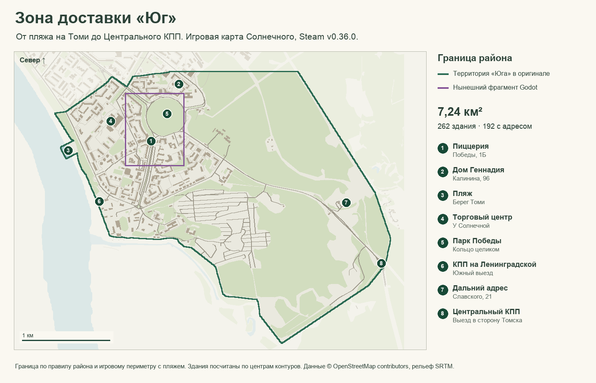

# Godot · один район Солнечного

[← Беклог идей](../IDEAS.md)

**Статус на 18.11.2026.** В Godot есть играбельный фрагмент «Юга» с тремя рейсами. Ниже — задание на перенос взрослой игры Steam в один законченный район. Начать с границы и проходимости, затем дать автору проехать первую смену на «Семёрке». Редкие события, долгую карьеру и другие режимы довести до приёмки в том же районе.

<b>GD27</b> · Перенести взрослую «Птицу Пиццу» в один законченный «Юг» · <b>XL</b>

**Эталон.** Последний опубликованный пакет для Steam Deck — [v0.36.0, 17 ноября](https://github.com/ndrwbv/bird-delivery/releases/tag/v0.36.0), файл `bird-pizza-deck.tar.gz`. Исходники этого выпуска зафиксированы [коммитом be70630](https://github.com/ndrwbv/bird-delivery/tree/be70630f218468c034789106ad597afbcc78c957). В сборке `steam` исходная игра работает на Three.js в Electron. Номер SteamPipe BuildID для магазинной ветки не подтверждён. Все имена модулей оригинала ниже относятся к этому коммиту и каталогу `src/game/`, если не указан другой путь. В `game.js` искать названный обработчик. В старых справочниках описаны также снятые сценарии.

**Решение автора, 18.11.2026.** Один район, одна модель автомобиля — ВАЗ-2107 «Семёрка», без угловатых машин, без коллекционных предметов и без бист-мода. Прочие действующие механики взрослого билда переносим. Сохраняем темп, управление, характер города, доступные действия и последствия. Улучшаем читаемость графики и стабильность на физической Steam Deck с высокой графикой. Во всех надписях город — «Солнечный».

**Порядок для исполнителя.**

| Этап | Рабочий результат, который можно показать | Задачи |
|---|---|---|
| 1 | На карте видна окончательная зона доставки. Из пиццерии можно доехать к Геннадию, на пляж, в мастерскую и обратно двумя разными путями там, где улицы образуют петлю | [GD28](#gd28) |
| 2 | На одних кнопках в обоих билдах можно проехать кольцо, войти в занос, задеть бордюр, включить нитро, заглохнуть и снова завестись. В Godot уже нет биста и чужих кузовов | [GD6](#gd6), базовые действия [GD29](#gd29) |
| 3 | Новая карьера Жени от выбора языка до первого чека и следующего входа. На этом маршруте присутствуют окончательные интерфейс, звук, зима, заказ, квартира Геннадия и расчёт | [GD5](#gd5), [GD30](#gd30), [GD29](#gd29), сохранение [GD31](#gd31) |
| 4 | Обычная и поздняя смены живут по расписанию. Различаются кварталы по застройке, поток, погода, сервис, праздники и городские встречи | [GD4](#gd4), остаток [GD6](#gd6), [GD31](#gd31), [GD7](#gd7) |
| 5 | Доступны свободная езда, быстрые и катастрофические заезды, доски, настройки и платформенные функции. Графика и длинная сессия приняты на Deck | [GD32](#gd32), [GD33](#gd33) |

Вести таблицу выполнения в соответствующем этапе этого трека. После каждого этапа у записи механики указать источник и условие запуска в v0.36.0, место или экран Godot и наблюдаемый исход. Если вход выглядит доступным по справочнику, проследить реальный вызов от меню, выдачи заказа или шага мира. Необходимость ехать в удалённый район устранять расстановкой и условиями прогрессии в «Юге». Порядок показа и игровые критерии собраны в [GD33](#gd33).

<b>GD28</b> · Провести границу «Юга» по местности и собрать связную дорожную сеть · <b>L</b>

**Граница по уточнению автора, 18.11.2026.** Перенести целиком исходную зону доставки №1 «Юг». С запада её ограничивают берег Томи и городской забор с карманом пляжа. С севера линия идёт по Солнечной и Коммунистическому к жилым кварталам у Калинина. Внутри остаются ТЦ, парк Победы с полным дорожным кольцом, жилые дворы по обеим сторонам основных улиц, Чапаева, Ленинградская и весь выезд по Славского через дальнюю застройку и посёлок до Центрального КПП. Перекрёсток Славского и Ленинградской остаётся промежуточным транспортным узлом. Юг — игровая зона доставки Солнечного, воспроизведённая по карте оригинала.

**Как получена карта.** Взято фактическое правило `districtAt(x,z) === 0` из `src/maps/seversk/index.js` и его пересечение с городским периметром после `beach.prepare`. Один полигон `SOUTH` покрывает часть района. Остальную территорию определяют продольные полосы и особая юго-восточная часть за железной дорогой. Площадь по маске с шагом 4 м — **около 7,24 км²**. По среднему положению вершин исходных контуров внутри 262 здания, у 192 записаны улица и номер. Это контроль полноты импорта. Число подходящих заказов считать отдельно по входам, назначению зданий и доступности. Прежняя рамка Godot занимает около 0,56 км².

| Опорное место | Зачем оно нужно |
|---|---|
| Пиццерия «Птица Пицца», Победы, 1Б | Старт смены, выезд курьеров, погрузка, обед, обратный путь, завершение. Использовать фактическую дверь и парковку у модели |
| Южный проезд, 23 · Чапаева, 20 · Победы, 7 | Три существующих адреса Godot. Из пиццерии сейчас 601, 459 и 233 м соответственно по сохранённым путям. Это ранние образцы для сравнения, каталог пополнить обычными домами и входами |
| Калинина, 96, дом OSM 119208348 | Двор, тротуар, место высадки и подъезд Геннадия остаются целиком. Сохранить адрес, подъезд 1, этаж 3, квартиру 10 и маршрут с улицы |
| Парк Победы и кольцо | Круговое движение, объезды, прогулки и движение камеры. У старого участка восточная граница проходит по локальному X=310 м, дуга доходит примерно до X=329 м |
| Пляж на Томи, центр [2167, 2180] в координатах города | Подъезд и спуск к воде, проходимая кромка, заказ летом, береговая растительность, вода/лёд и эвакуация |
| Торговый центр у Солнечной, дворы и гаражи, КПП на Ленинградской, Славского, 21 и 44, Смолокурка, Центральный КПП | Короткие и дальние рейсы, места для парковки, ремонта, объездов, остановок и событий. Ближняя окраина и выезд к Центральному КПП сохраняют разную длину рейса |

**Проверка масштаба по дороге.** На исходной сети улиц внутри контура есть непрерывные пути от ближайшего к пиццерии дорожного узла до КПП на Ленинградской (1,14 км), Калинина, 96 (1,68 км), Славского, 21 (3,21 км) и Центрального КПП (3,82 км). Здесь длина — сумма сегментов кратчайшего пути между ближайшими узлами дорог классов 1–7, без учёта направлений движения, дворовой парковки и пешего подхода. Это ориентир для геометрии. Для срока заказа и расчёта денег брать маршрут игрового навигатора. Стартовый пул коротких рейсов расширяется по исходному ритму смены, поэтому новичку доступен большой район без обязательной четырёхкилометровой первой доставки.

**Как собрать.** В прототипе рамка 675 × 829 м `[-365,-545,310,284]` в метрах относительно `city.meta.home = [3181,2071]`. В `godot/tools/capture-original.mjs` она задана числами, `bake-south.mjs` оставляет сегмент дороги только с двумя концами внутри. Из-за этого улица обрывается, даже когда её середина попала в кадр. Вынести игровую границу в общий ресурс. По карте `src/maps/seversk/index.js`, `city-data.js` и авторским `edits.json` обойти каждое пересечение края. Сохранить состав исходной зоны заказов. Исходные правила и выгрузку можно открыть по ссылкам на [код границы релиза](https://github.com/ndrwbv/bird-delivery/blob/v0.36.0/src/maps/seversk/index.js) и [данные города](https://github.com/ndrwbv/bird-delivery/blob/v0.36.0/src/maps/seversk/city-data.js). Для физической кромки брать целый двор, ограду, разворот или весь перекрёсток, включая встречное направление. Если маршрут внутри зоны временно пользуется приграничным проездом, добавить его проезжую часть как транзит без новых адресов и отсечь только следующее ответвление. Оставить снаружи полосу видимого окружения. Оболочка рендера может оставаться прямоугольной.

**Один источник границы** для дорожного и пешего графов, проездов дворов, адресов и входов, GPS, трафика, остановок, спавна людей, служб, событий, предметов и эвакуации. На вылетных дорогах использовать реальные шлагбаумы, КПП, развороты и подъезды к ним. Вне дорог использовать плавное замедление края из `softedge.js` (предел 25 м) как страховку. Предусмотреть края и для полёта, крыши, падения в воду, пешего этапа и катастроф. Навигатор прокладывает путь к доступному месту остановки и дальше к нужной двери. Нельзя отбрасывать машину с уроном на видимой полосе или вести игрока сквозь забор.

**Роли, которые раньше требовали другого района.** Внутри одного `south` выделить спальный двор, богатый и бедный адреса, гаражи/промзону, мастерскую, локальную опасную зону, площадку концерта/марша, остановки, клуб, каток, стройку и опушку. Сначала использовать существующий объект подходящего типа. Для отсутствующего завести в таблице привязок исходную роль, местный адрес, радиус, доступ по дороге/пешком и смену первого появления. Переселять только роли, которым это действительно нужно. Первые поездки у базы безопасны. Для событий других пиццерий использовать поздние смены местной пиццерии и реальные площадки.

**Приёмка карты.** Сравнить множество ID домов и входов с каталогом исходного «Юга». Зафиксировать все расхождения с причиной. Обязательные поездки — короткий двор Победы, Калинина, 96, летний пляж, длинный заказ на улице Славского, свободный проезд к обоим КПП. Для каждой выдаваемой остановки есть подъезд от базы, парковка, пешая связь с правильной дверью и обратный путь. Автобусный маршрут замкнут через остановки, у служб есть путь на вызов и обратно, перекрытие сохраняет объезд. Ни полный круг, ни подъезд, ни целый дом не исчезают на краю. На большой карте нет выбора соседних районов или штриховки открываемых районов. Проверить объезд при ДТП и ошибочный адрес во время рейса, при разрушении дома исключить адрес до восстановления. Исходники графа и адресов — `streetgraph.js`, `roadends.js`, `routeyard.js`, `routechain.js`, `routemix.js`, `districts.js`, `addresslayout.js`. Точки Godot — `godot/tools/delivery-addresses.mjs`, `godot/district_map.gd`.

<b>GD6</b> · Воспроизвести езду «Семёрки», покрытия, погоду и последствия контактов · <b>XL</b>

| Что переносить | Что сделать в Godot и как сравнить | Эталон v0.36.0 |
|---|---|---|
| Руль и педали | Оставить четырёхточечную опору прототипа. Параметры базы «Семёрки» — предел 44 м/с до множителей, разгон 29, задний ход до 15 м/с, управляемость 3/10, минимум радиуса 6,4 м. Набор/отпускание/перекладка руля 0,35/0,20/0,55 с. Перенести накат, тормоз → задний ход, склон, поворот на скорости, противоруль, ручник, управляемый срыв и выход из дрифта. На одинаковом отрезке записать скорость, остановочный путь, радиус и угол заноса | `econ.js`, `game.js::driveStep`, `drift.js`, `carbump.js` → `godot/vehicle.gd` |
| Покрытия и высота | Асфальт, грунт, газон, песок, мокрая дорога, ямы, бровка бордюра, ступень тротуара, лужи, снег, колея и лёд. Различить сцепление, тормоз, звук и след каждого колеса. Мост, арка, навес АЗС, трамплин, крыша, приземление и выезд из застревания используют верную высоту. У воды — мелководье, погружение и исход для машины. Сверять один бордюр прямо и наискосок | `roadwear.js`, `curbs.js`, `softsurfaces.js`, `jumps.js`, `roofs.js`, `ice.js`, `tracks.js`, `unstuck.js` |
| Урон и жизнь | База 7 сердец, защита от повторного списания около 0,9 с. Различать касание, мятину, потерю сердца, удар в бок, повторный наезд и взрыв. Слабо задел — видна царапина без обязательного списания сердца. Кузов по сторонам, двери, бамперы, крышка багажника, фары, стёкла, обломки, дым при ≤2 сердцах, огонь при ≤1. Отдельно от сердец — износ мотора, пробег, заглох/стартер, ремонт. При взрыве — окно платного воскрешения (обычно 3000 ₽, затем ×2 в этой смене, льготная первая цена 1000 ₽ доступна раз в 3 смены). «Семёрка» спускается, даёт полное здоровье и щит на 3 с. Подо льдом теряется пицца, возвращение на берег и новый заказ без штрафа. Отказ/нехватка денег ведут на итоги. Обычное утопление отрабатывать по отдельной ветке | `carhit.js`, `cardent.js`, `carwreck.js`, `foewreck.js`, `impact.js`, `crashfx.js`, `cars.js`, `game.js` → `car_damage.gd`, `vehicle_lamps.gd` |
| Предметы смены | Кофе/нитро с удержанием и расходом, пополнение в длинных проездах, аптечка +1, щит 10 с, редкое золотое сердце до конца смены (при полных жизнях даёт лишнюю ячейку). Видимость, частота, интервал и повторное появление зависят от смены и маршрута. Никакого каталога предметов. Сохранить собственные вероятности оставшихся бонусов, освободившиеся броски биста пропускать. Убрать тип 3 из `road_pickups.gd` и ветви `beast_time` из машины, HUD, аудио, эффектов и условий удара. Обычное нитро продолжает работать | `game.js::takePickup` и участок `FXS`, `roadcoffee.js`, `pickinst.js`, `econ.js` |
| Суточный цикл и сезоны | Новая карьера начинается ясной зимой. Первый зимний цикл 4 смены, затем зима/весна/лето/осень по 3/3/4/3, переходные состояния, календарь вперёд. На сцене меняются солнце и тени, небо, туман, окна, листва/листы на земле, одежда, следы, фары, встречные блики, видимость, звук и набор людей/занятий | `daytime.js`, `seasoncycle.js`, `seasons.js`, `sky.js`, `windows.js`, `nightlight.js` → `south_atmosphere.gd`, `street_lighting.gd` |
| Погода | Ясно, жара, золотая осень, дождь, гроза, снег/метель, ураган и смерч. Точные сезонные веса брать из `weather.js`. Дождь и снег приходят волнами, молния и дальний гром разделены во времени. Брызги и лужи, смывание крови, дворники, сугробы, рыхлые валы, прорезь от колёс и пролом льда. При урагане действуют ветер, предметы, повреждение дома и временная стройка. Сохранить условия позднего допуска урагана и защиту адресов текущего заказа | `weather.js`, `hurricane.js`, `twister.js`, `winterroads.js`, `snow/`, `snowimprint.js`, `wipers.js`, `carblood.js`, `cardirt.js` |

В Godot уже есть геометрия «Семёрки», ходовая, деформация, отрыв частей, следы и ночной свет. До визуальной переделки зафиксировать положение колёс, обзор и поведение камеры. На одном маршруте сравнить выпуск и порт при одинаковых состоянии машины, поверхности, погоде и вводе. Согласовывать ощутимое изменение с автором по записи одной и той же поездки.

<b>GD5</b> · Собрать настоящую смену от отметки у управляющей до итогового чека · <b>XL</b>

**Состояния.** Выбор смены → отметка команды в чате (2,45 с, часы ещё стоят) → накладная → выдача/погрузка и выезд → остановка у клиента → вручение и расчёт → следующий адрес либо возврат на базу → обед, новый заказ, возможный развоз коллег или закрытие → чек. Подключить эти состояния к общему времени, вводу, звуку и сохранению. Показать набор и движение коробок, открытие/закрытие багажника, курьера и водителя. Остановки мира и таймеров повторяют оригинал в конкретных окнах. Три фиксированных рейса, вступительный автопробег и упрощённая ставка из `district_shift.gd` — части демки, по ним нельзя балансировать карьеру.

| Система | Правила и характерные исходы |
|---|---|
| Время и ритм | Смены 1–3 ≈4 минуты, 4–8 ≈6, с 9-й ≈8. Ранний Юг 09:00–24:00, предусмотрены дневные смены и отдельный праздничный график. Перенести волны щедрости сессии, чередование коротких и длинных маршрутов, кульминацию и последний заказ. Первое обычное назначение 60–350 м, до 450 м по дороге. Учесть, когда пора заканчивать, разрешённое завершение активной доставки, возврат до закрытия и досрочный выход с паузы. После местного эквивалента открытия второго района включается исходный круглосуточный цикл с продолжением от прошлого часа |
| Выбор адреса | Выбирать вход и безопасную остановку из связного каталога. Исключать недоступные адреса, учитывать использованные подъезды, улицы, сектора, навык курьера, размер смены, центр и окраину. Одиночный, несколько пицц 2–4 получателям по одному адресу, сборный до 7 адресов в допустимом порядке, срочный, сюжет, пляжный, специальный заказ на событие, развоз сотрудников. В первой смене один адрес в накладной, группа допустима. Реальные сроки считать по дорогам, длину цепочки и выбор целей — по таблицам оригинала |
| Навигация и срок | Разные метки текущей, следующей и пройденной точек. Оранжевая полоса к клиенту, зелёная обратно. Первая смена с полосой, затем однократный вопрос «Оставить путь на дороге?». Избегать дрожания маршрута, срезов через дома и мгновенной смены подъезда. Особое исключение — клиент ошибся адресом, с 3 завершённых смен, 7%, максимум раз за смену и при выполнении остальных условий. Зачеркнуть старый адрес, показать сообщение, заново посчитать срок и дорогу |
| Стоимость | База 640 ₽ + 1,12 ₽ за метр пути, затем множители и округление как в `econ.js`. Считать адреса, пиццы, чаевые, районный коэффициент, погодные надбавки и доход коллег раздельно. Все адреса сборного вовремя дают +10%. Срочный ×2,5. У обычного опоздания оплата 45%, штраф 12% минимум 150 ₽, при срыве срочного штраф 30% минимум 400 ₽, за опоздание обратно 10% минимум 150 ₽. Суммы показывать в игровых рублях, повторно ×8 не умножать |
| Вручение | Остановиться по правилам скорости и радиуса. Маркер, видимые коробки в руках, поворот/поза клиента, взгляд, речь/эмоция, передача одной или стопки по очереди, банкноты и чаевые, сообщение, уход с коробкой. Расчёт только после фактического вручения. Падение клиента, лёгкий удар до сдачи, гибель, уход со сцены во время выплаты — разные исходы. Сбитый живой клиент лишает чаевых, гибель списывает ставку адреса и сама по себе не завершает смену. Повреждённый багажник и машина остужают заказ. На пороге холода 0,25 все чаевые теряются, реакция выбирается один раз |
| Люди на смене | Ирина Сергеевна, Женя и коллеги с именами, портретами, разным темпом и заработком. Общий чат, обеденный опрос после 14:00 и только один обед на базе. Три ответа дают ремонт, прибавку к чаевым либо сердца. Со второй смены управляющая замечает простой, пишет в чат, в чеке появляется его длительность. При росте рейтинга приходит одно SMS. Рейтинг за текущую смену и накопленный рейтинг пиццерии. Поздний развоз — предложить/отказаться, дождаться последней пиццы, посадить 2–3 сотрудников, видеть посадку и выход, отвезти по домам к сроку, 1600 ₽ за пассажира по условиям исхода |
| Итоги и рост | Полный финиш — 1500 + 300 ₽ за заказ до множителя. Победителю рейтинга — 1000 + 500 ₽ за коллегу, чистая смена — звезда. Сохранять накопления, заработанное за смену, личное умение, рекорды, рост пиццерии на 0/8/20/40/70 сменах, состав до 6 коллег, ранги и респект. Задания дня с 5/8/12-й смены по 1/2/3, условия серии, провалы и выдача ₽ один раз, включая хулиганские задания. Удалённая механика не может выпасть целью |

**Перенос.** Отделить расчёт смены от `south_drive.gd` и анимаций. Ту же выдачу и расчёт используют HUD, чек и рейтинг. Заказ и остановка имеют стабильные идентификаторы. Пауза, повторный вход в зону оплаты и запоздалый сигнал завершения анимации обрабатываются идемпотентно. Сверить ведомость хотя бы для вовремя, поздно, срочного, группы, остывшей пиццы и досрочного конца, включая нулевые чаевые.

**Источники.** `career.js`, `orders.js`, `orders.config.js`, `econ.js`, `skill.js`, `rhythm.js`, `wrongaddr.js`, `routeask.js`, `pizzacold.js`, `handover.js`, `handcam.js`, `crewride.js`, `crewrank.js`, `growth.js`, `daily.js`, `mealchat.js`, `shiftcash.js`, `shiftend.js`. [Правила заказов](../ORDERS.md).

<b>GD30</b> · Перенести клиентов, пешую доставку и квартиру Геннадия · <b>L</b>

- Для обычной остановки повторить именно порядок вручения, предусмотренный в `game.js::checkArrival`, включая скорость, близость к получателю, выход, выбор правильного клиента, передачу, камеру, оплату и возврат управления. В прототипе `courier_on_foot.gd`, `delivery_dispatch.gd`, `delivery_handoff.gd` и `entrance_door.gd` уже дают движение, видимые сумки и дверь. Убрать обязательное универсальное E у каждой остановки, если в тех же условиях оригинал вручает автоматически. Перенести пешие состояния туда, где они действительно доступны.
- Для каждого получателя перенести выбор имени, пола, одежды, портрета, ника и реплик, совпадение человека на улице с карточкой и человеком после передачи. У группы у каждого своя коробка и поза. Поворот к курьеру, вещи в руках, ожидание и уход на тротуар должны переживать наезд и прерывание разговора. Оплату за уже вручённую коробку нельзя получить повторно.
- **Финал первой смены обязателен.** Геннадий на Калинина, 96. Подъезд 1, этаж 3, вторая дверь, квартира 10. Сохранить подход от припаркованной машины, штатные состояния входа/подъёма и накладную с адресом, открытие нужной двери, освещение, взгляд от первого лица, 2D-актёра в объёмной квартире, реплики и последовательность жестов по релизному сценарию. В выборе «диабло» возвращает к вопросу, «пеперони» продолжает сцену. После передачи коробки и денег вернуться к машине и в пиццерию, дать игроку завершить сцену и после полуночи. На второй смене оплаченная глава повторно не выдаётся. Подготовить показы ошибочной двери, правильной двери и повтора ввода на передаче.
- Не переносить из старого задания GD5 учебного Стёпу, Глеба, старых постоянных клиентов и набор их поручений. В релизе `STORY_PEOPLE` содержит Геннадия, `SIDE_ORDERS` пуст, а `doorstep.planOk()` возвращает false для случайных мини-игр обычной доставки. Сохранить используемые сюжетной сценой компоненты лестницы и диалога, настройку доступности мини-игр и отдельные сервисные просмотры. Режим `?fpdeliver` и отдельные `?doorpreview` / `?stairspreview` обозначить как экспериментальные входы, случайно не подмешивать их в карьеру.
- Сверять тексты по вызванным строкам тега, отдельно — указания о стиле персонажа и авторских жестах. Финальный пример агента должен начинаться в городе и заканчиваться на итогах, включая неверный ответ, потерю фокуса и повторный вход в игру.

**Источники.** `story.js`, `storyparking.js`, `orders.config.js`, `doorstep.js`, `minigames/{stairs,stairs3d,doorscene,door2d,doorcoach,intercom}.js`, `chat.js`, `talkface.js`, `carglass.js`, `game.js`. [Геннадий и действующие персонажи](../LORE.md), [спрайты персонажа в квартире](../CHARACTER-2D.md).

<b>GD29</b> · Вернуть все игровые экраны, управление и звуковую обратную связь · <b>XL</b>

[Четыре экрана из опубликованного пакета v0.36.0 — меню, накладная на телефоне, карта и пауза](../reference/godot-steam-v036-ui.jpg). [Ещё шесть экранов — быстрый заезд, гараж, доска почёта, рекорды, настройки и карточка Жени](../reference/godot-steam-v036-windows.jpg). Снимки сделаны в исходном размере и показывают также элементы, которые автор исключил из порта.

| Экран или действие | Что видит и делает игрок |
|---|---|
| Первый вход | Логотип, сменяющиеся фразы загрузки, выбор из 15 языков, один профиль Жени. При проблеме чтения сохранения — повторить. Главное меню в виде рабочего стола с предметными иконками в доке, карточкой курьера, версией и выходом. При быстром входе Deck первое нажатие «Начать смену» на раннем экране Deck может сразу запустить подготовку города. В обычном окне смены есть карта, два вида пиццерии, управляющая, состав и кнопка старта |
| Перед поездкой | Короткая отметка в чате, накладная с получателем, адресом/подъездом, набором пицц, оплатой и обзором на карте. Газ принимает заказ. Отразить одиночный, группу, несколько адресов, срочность, ошибочный адрес, уже выполненные доставки. Не перекрывать машину несколькими одновременно открытыми карточками |
| Телефон и радар в движении | Справа внизу телефон в стиле iPhone 4, часы, жизни, заработок за смену, получатель, расстояние и срок, лидер смены, подробности рейтинга, состояние при оплате. Слева прямоугольный радар с улицами, маршрутом, игроком, пиццерией и целью, внизу шесть делений нитро и температура пиццы. В движении телефон сворачивается/сдвигается, на оплату разворачивается. Компактное, раскрытое и временно закрытое состояния. Карточка справа сверху и постоянный спидометр `godot/hud.gd` — интерфейс текущей демки, полный игровой макет собирается заново |
| Чат, рейтинг, подсказки | Общий канал «Курьеры», «Личные», история, участники, аватары, обеденные ответы и короткие автоответы. Портрет и речь управляющей/клиента, облачка у людей в городе, подсказки управления, очередь уведомлений по приоритету. Итог передачи и чаевые, включая 0 ₽, приходят один раз. Рейтинг не вытесняет открытый диалог. После выплаты телефон возвращается к прежнему состоянию |
| Большая карта | Полный «Юг» с панорамированием, масштабом, понятной легендой, местом машины, точкой заказа/возврата, GPS, препятствиями, КПП, светофорами, службами и активными событиями. Открытие замораживает игру, закрытие восстанавливает предыдущий экран и ввод. Убрать слой находок, экран выбора района и замки другой географии. Сохранить карту внутри накладной и окна смены |
| Пауза и конец смены | Рабочий стол паузы, лист итогов и накладная, текущие цели дня, контроль управления, карта, музыка, настройки, продолжение, доступная отмена заказа и досрочный конец. В v0.36.0 «Закончить смену» действует сразу. Полный чек выводит составляющие заработка, штрафы, задания, звезду, положение и премию, машину, копилку, возможную ставку, следующий экран. Доска почёта, свои рекорды, карточка Жени и мировая таблица — отдельные окна |
| Настройки и помощь | Игра, графика, звук, управление, язык. Камера, мини-игры у клиента, подсветка пути, телеметрия и текст политики, версия, авторы, лицензии, сброс с подтверждением в главном меню. У графики пресеты и ручные параметры, 30/40/60/без ограничения, дальность, город за меню, разрешение, комнаты за окнами, эффекты, частота дальних участников, сглаживание, тени и динамическое разрешение. На Deck высокий профиль 1280 × 800. Мастер-звук, уровни музыки/эффектов/мотора, музыка вкл/выкл и следующий трек. Смена языка из главного меню. Все экраны проходят с геймпада, с явным фокусом, понятным «назад», сменой глифов при смене ввода и читаемым длинным переводом |
| Контекстные кнопки | В игре RT/LT газ/тормоз и назад, левый стик руль, B ручник, A или RB нитро, Y карта, View камера, правый стик осмотр, Menu пауза, X полёт при наличии улучшения, R3 звук, L3 музыка, ↓ следующий трек. На клавиатуре WASD/стрелки, Space, Shift/N, Tab, V/ПКМ, Esc/P, Z/J, M/B/F. В меню A/Enter подтвердить, B/Esc назад. В большой карте стик/клавиши двигают, курки/колесо меняют масштаб. Смена вида — близкая, дальняя, кабина. Осмотр с возвратом, ограничение камеры в арках/у стен, тряска, салон и блики. Исправить привязки в `project.godot`. Сейчас A/E взаимодействует, X/R отправляет к базе, Esc выходит из процесса. Разделить удержание и новое нажатие при смене экрана, сохранить вибрацию когда она применяется в эталоне |
| Звуковая картина | Сохранить четыре слоя мотора, пять передач, стартер, перебои, отсечку, скольжение по сухому/мокрому, удар и скрежет по материалу, клаксон и сирены. Слышимость от положения камеры и источника, город/двор/лес, стройка, толпа, дождь, гром с задержкой. У заказа, чека, кнопки и рейтинга свои сигналы. Шесть синтезированных мелодий, выбор по сезону/времени и празднику, переход 2,5 с, приглушение в паузе и диалоге, отдельная атмосфера подъезда. В теге каталоги музыки и SFX без записанных треков — инструментальные партии и эффекты брать из синтеза, сверять также по [каталогу звуков](../SOUNDS.md) |

**Источники.** Вход `src/main.js`, `menu.js`, `menudock.js`, `shiftapp.js`, `shiftcheckin.js`. Поездка `hudphone.js`, `hudmapios.js`, `fmlegend.js`, `ordersheet.js`, `shiftwallet.js`, `game.js::hudStep/drawRadar/drawFullMap/renderPause`. Сообщения `notifyq.js`, `chat.js`, `dialog.js`, `payfx.js`. Остальные окна `settings.js`, `gfx.js`, `board.js`, `honor.js`, `couriercard.js`, `credits.js`. Ввод `src/input/{gamepad,glyphs,padmenu}.js`, `camview.js`, `camlook.js`, `camroof.js`. Звук `motor.js`, `ambience.js`, `sfxsynth.js`, `music.js`, `chiptunes.js`.

<b>GD31</b> · Замкнуть экономику, гараж и сохранение долгой карьеры на одной машине · <b>L</b>

1. **Одна модель автомобиля.** В гараже и на дороге использовать одну узнаваемую «Семёрку» с колёсами, стёклами, салоном, оптикой и отделяемыми деталями. Она бесплатная и остаётся у игрока. Снять каталог покупки/продажи других машин, прокрутку пустого списка и подбор случайного кузова. В трафике варианты «Семёрки» различать цветом, шашечками такси, знаком курьера, фирменной раскраской и огнями службы. Старый `south-traffic-models.glb` содержит другие силуэты. Обновить запекание потока, стоянки, превью, дальние модели и обломки. Запрет включает прямоугольные заменители, в том числе на больших расстояниях. Двухколёсные участники и прицеп выполняют отдельные роли. Для автобусного маршрута, дорожной техники и фуры перенести остановки, пассажиров, заграждение и буксировку с разрешённым автомобилем, прицепом и реквизитом. Вид и пассажировместимость такой службы — осознанная адаптация. Обычная посадка в салон ограничена видимыми местами.
2. **Гараж и стоимость владения.** Техпаспорт, обучение при первом входе и пропуск обучения, осмотр со всех сторон, покраска за 1500 ₽, по три уровня брони и мотора, +1 сердце или +4% за ступень по таблице, звёзды и цены. Сохранять купленное и установленное отдельно. Износ мотора, пробег, остановка двигателя с 5-й смены при условиях, попытки стартера, мастерская дяди Жени, скидка, оплата или отказ при нехватке денег. Исправный мотор и кровь дают бесплатную мойку, повреждение только кузова — бесплатную правку. Платный ремонт двигателя чинит и кузов. АЗС сохраняет навес, колонку, свет, объезд и камеру. Расход бензина и покупка топлива у колонки отсутствуют.
3. **Дополнительное оборудование.** Перенести штатные ракеты краткого подъёма за 900 000 ₽ и игровой автоматический гранатомёт на крыше за 800 000 ₽ с сохранением боезапаса, зарядки, отклика, HUD и условий применения из `flycar.js`, `turret.js`, `garage.js`. Подъём «Семёрки» — 5 м, удержание 3 с, затем снижение и перезарядка. Исключение остальных кузовов убирает заводские характеристики родстера и грузовую вместимость «Буханки». Доступный на «Семёрке» полёт сохраняет прохождение над низкой крышей и запрет взлёта под перекрытием.
4. **Дальняя прогрессия без смены карты.** Когда оригинал открыл бы следующую пиццерию, в «Юге» открывать её условия смен и событий. Считать только смены с ≥3 доставками. Последовательные пороги исходника 4/5/5/6/6/7/7 таких смен, накопленные отметки 4/9/14/20/26/33/40. В таблицу соответствий включить круглосуточный график, дальность и оплату, скорость, состав заказов и поздних встреч, обращения управляющей, календарь и прежние условия режима «весь город». Старшие условия давать в знакомой географии, при необходимости распределять заказы между жилой частью и окраинами. Выбор семи пиццерий и команду «возвращайтесь в новый район» заменить местным назначением. Не раздувать интерфейс фиктивными районами.
5. **После чека.** Взрослое «депнуть» доступно с копилкой от 50 ₽. Сохранить предложение, отказ, шаг ставки, выигрыши и возврат к чеку. По номеру смены чередуются автомат 777, красное/чёрное и теннис. Первая ставка сессии выигрывает, дальше вероятности 10%, 18/37 и 50% соответственно, при выигрыше выплата ×2. Стационарная ёлка-турель и пожертвования скрыты `SPEND_MORE=false`. Это другая покупка, чем оборудование машины.
6. **Что переживает перезапуск.** Одна карьера Жени, версия схемы, стабильный идентификатор владельца. Сохранять кошелёк, награды, открытые возможности, уровень и машину, пробег, статистику, использованные входы, сезон, время, героя и исход квартиры, опыт и настройки. При обычном холодном запуске оригинал начинает из меню. Активные таймеры, положение машины и незакрытый заказ не восстанавливаются. Сон Deck/оверлей при живом процессе замораживают сцену. Нативную запись суммы и завершения сюжетной остановки делать атомарно и с защитой от повторения. При переносе старого профиля читать копию, выбрать «Семёрку», сохранить её прокачку и независимые деньги/статистику. Удалённые коллекции и бист игнорировать, старые идентификаторы/районы преобразовать однократно. Отсутствующий или повреждённый файл отличать от новой карьеры. При ошибке оставить исходное сохранение и предложить повторить. Сброс требует подтверждения и сохраняет настройки, исторические рекорды, идентификатор и уже полученные достижения.

**Источники.** `cars.js`, `garage.js`, `garagetour.js`, `econ.js`, `flycar.js`, `turret.js`, `dep.js`, `heroquests.js`, `respect.js`, `districts.js`, `transfer.js`, `cityopen.js`, `singleprogress.js`, `progressboot.js`, `src/platform/{steam,common}.js`. Первая полезная проверка — купить улучшение, пройти один адрес, закрыть и открыть приложение, повторить чтение того же профиля. Проверить нехватку денег, старую активную машину и отказ от ставки.

<b>GD4</b> · Оживить улицы, дворы, пассажиров и службы по правилам оригинала · <b>XL</b>

| Участники | Поведение, которое должно быть видно на маршруте |
|---|---|
| Дорожный поток | Плотность по часам, полосы и перестроения, заблаговременный поворотник, приоритет на кольце, светофор/зебра, подрезка, очередь, однополосный разъезд, тупик и выезд со стоянки. Такси останавливается для высадки. Машины появляются и исчезают вне взгляда, могут тормозить за другим участником и обходить перекрытия. Чужая машина получает урон, водитель выходит и возвращается либо преследует игрока. Поток из готовых замкнутых сплайнов `district_traffic.gd` дополнить графом с выбором маршрута |
| Общественный транспорт и службы | Рейсовые остановки, ожидание, посадка/выход и опоздавший пассажир. Скорая едет на вызов по дороге, события собирают очередь и освобождают проезд. Зимой меняется состав двухколёсного потока. Мопед/самокат со слетевшим седоком продолжает своё движение, отдельный самокат падает на бок. Коневозка с отцепляющимся прицепом. Свои курьеры едут за заказами, «Вселенная суши» ведёт себя спокойно, «Королева Бургеров» подрезает и таранит. Условие одной машины описано в GD31 |
| Пешеходы | Одиночки, пары, человек с вещами, клиенты, сидящие у лавки, гости входов и остановок. Переходят дорогу, реагируют на машину и сигнал, уклоняются и возвращаются. Лёгкое касание, падение, подъём и повторный контакт, удар боком или сверху отличаются. Сохраняются модель, одежда и вещи этого человека. Предмет вылетает, ложится на реальную поверхность, хозяин может вернуться за ним. Снесли лавку — человек падает. Взрослые эффекты, реакции и машина скорой под флагом взрослой версии. Водитель, клиент и прохожий по-разному влияют на заказ |
| Дворовая жизнь и животные | Группы на лавках, курилка/кальян, двор у гаражей, шашлыки, домино, пары, балконы и граффити. Во дворе играют в мяч, зимой — хоккей, снежки и катание. Корт, турник с подтягиванием игрока, воздушные змеи и дроны, купающиеся, люди у берега и пляжный заказ. Стая птиц/голубей разлетается. Коты прыгают на крыши и уходят в подвал, в лесу лось пугается или бодает и тормозит поток, заяц и лиса убегают. Сезон, время, место и удаление из поля зрения управляют появлением и восстановлением |
| Предметы и препятствия | Отличать твёрдые стены, арки, ограды, ворота, шлагбаумы и газонные ограждения от сносимых столбиков, знаков, фонарей, урн, скамеек, остановок и контейнеров. Масса, звук, ответ на скорость, осколки, падение света и счётчики сноса. Сетка футбольной коробки, дворовые проезды, двор с закрытым въездом и объезд, разбиваемое стекло, дерево и куст отвечают по-разному. Различать физическую опору, рендер и деспавн обломков |

**Существующая база.** В снимке Godot есть 23 дорожки пешеходов, 21 припаркованная машина, базовый поток, контакты, падения и следы. Текущие `pedestrian*.gd`, `traffic_vehicle.gd` и `street_furniture.gd` использовать как отправную точку. Брать реакции из `flowlane.js`, `trafficgrid.js`, `yardcars.js`, `narrow.js`, `rings.js`, `buses.js`, `mopeds.js`, `horsebox.js`, `svcpath.js`, `rivals.js`, `flowdrivers.js`, `peddodge.js`, `pedcollide.js`, `hits.js`, `carried.js`, `yardlife.js`, `actorlife.js`, `courts.js`, `workout.js`, `fauna.js`, `cats.js`, `beach.js`, `junk.js`.

**Приёмка.** Встать у зебры на кольце в час пик, подождать у остановки, перекрыть узкий проезд, задеть лавку и вернуться через двор. Видно, кто кому уступил, где пассажир вышел и что случилось с человеком и его вещами. После отъезда службы, отмены заказа или смены сезона город не оставляет вечных пробок либо невидимых коллизий.

<b>GD7</b> · Перенести режиссёра, уличные события и календарь пиццерии · <b>XL</b>

Для каждого события вместе перенести условие допуска, физическое место, реакцию на игрока и способ завершения. Начать с одного события каждого размера. Затем подключить остальные к общим ограничениям `director.js` и `rhythm.js`, чтобы давать игроку спокойные отрезки, выдерживать паузы после крупного события и исключать несовместимые сцены. Редкий контент не должен случаться на каждом круге только потому, что район один.

| Группа | События и перенос в «Юг» |
|---|---|
| Дороги и стройки | Яма, дорожники, закрытая полоса, полный запрет проезда/дворовый шлагбаум, перекрытие на обратном пути, ДТП с пробкой и службами, стройка на пустыре, техника и объезд. Перенести знаки и предупреждения навигатора, освобождение полосы и удаление сцены. Учитывать защиту пути и входа текущей доставки |
| Встречи на дороге | Обиженный водитель выходит и преследует после столкновения. Отдельно вор пиццы и бегущий следом хозяин, таймер поимки 90 с и награда 2400 ₽. Соперники, курьеры своей сети, компании в цветах команд и прохожие реагируют по-разному. Различать исходы вмешательства, игнорирования и ухода |
| Опасная зона | В оригинале учебный «Юг» защищён, поздние зоны находятся в других районах. После соответствующего порога открыть местный участок у гаражей/промзоны вдали от учебной дороги и минимум в 150 м от базы. Мзда, слежка, облачко с репликой и испытание с сужающимся кольцом. Успел — уехал, промах или пропуск — до 10 000 ₽. Гопники прессуют прохожего, сигнал/вмешательство меняют исход. У мафии собственная выдача от третьего адреса, до одного случая за смену, выше шанс в опасной зоне. Поведение, награда, штраф и респект вести отдельно |
| Бренды и массовые сцены | Действующие конкурирующие точки и их маскоты, нападения на свои и чужие группы, помощь коллегам, рост/падение респекта и связанные чаевые/скидки, налёт на свою точку и оборона. Концерты, протест с пятью ступенями, марши, восстание, развязка, тумбы и надписи. Перенести зрителей, приход/расход толпы, реакцию на сирены/игрока. Для масштабного события подобрать площадь и автомобильный объезд в пределах района |
| Время и особые места | Вечерние компании и клуб, ночные персонажи у дороги, тёмной ночью костёр, ведьмы, опрокидываемый котёл и призраки. Зимой каток, летом пляж. У точки дорожники заказывают обед. Свадьбу и марафон из поздних пиццерий привязать к здешнему залу и улице с подходящими маршрутами. Сохранить варианты события, расписание, поведение гостей и схему заказа |
| Праздники | Первая зима — Новый год в четвёртую смену, в следующих зимах — во вторую. Последняя осенняя смена — Хэллоуин. Украшения, костюмы, праздничные пиццы, надбавки, чат и лента на чеке. На Новый год — корпоративные сборные, срочный к курантам и полночный салют. Хэллоуин меняет обстановку и заказ. Праздники привязаны к карьерному календарю. Они работают независимо от отключённых фестивалей на парковке |

**Источники.** `roadlife.js`, `backblock.js`, `construction.js`, `chase.js`, `game.js::spawnThief`, `gangland.js`, `world.js::gangTalk`, `ringfight.js`, `mafia.js`, `thugs.js`, `respect.js`, `crews.js`, `rivals.js`, `raid.js`, `protests.js`, `darknight.js`, `nightlife.js`, `pzevents.js`, `holidays.js`, `seasoncycle.js`. Приёмка — один пограничный случай на группу, включая отказ, побег, смену на паузе, закрытую дорогу и восстановление обычного состояния мира.

<b>GD32</b> · Перенести режимы заездов, достижения и вход через Steam · <b>L</b>

| Вход | Результат |
|---|---|
| «Покататься» | Свободная поездка по тому же «Югу» без заказов и таймера смены. Сохраняются ездовые действия, городская среда, карта, камеры, пауза и выход. Возврат не закрывает фиктивную карьерную смену |
| Обычный быстрый заезд | Открывается после одной завершённой смены. Путевой лист задаёт сезон (в том числе текущий), допустимую для него погоду и длину. В единственном районе/автомобиле не показывать пустые переключатели. Оригинал изолирует изменения карьеры на время заезда, замораживает опыт и отдельно сохраняет допустимые общие ключи и рекорд. На чеке — повторить, изменить условия, в меню |
| «Ад на земле» | Самостоятельный короткий летний заезд «Юга», доступен сразу из взрослого меню. Метеориты, предупреждение, вспышка/ударная волна, следы в земле, кратеры и опора колёс по деформированной земле, обрушение здания, завалы, пожары, дым, реакции людей и потока, защита активного получателя. Завершение сохраняет локальные последствия для следующего режима |
| «День после катастрофы» | Отдельный вход с самого начала. Показать сохранённые повреждения, ремонт дороги, завалы, леса/восстановление домов и доступные пути. Без истории использовать предусмотренный исходником пример. Обе версии катастрофы должны позволять довезти заказ. Возврат в карьеру восстанавливает её город и баланс |
| Доска почёта, рекорды | Личные достижения с прогрессом/скрытым условием и датой, собственные рекорды. `BEST_SHIFT` — отдельное окно с миром, друзьями и своим местом, офлайн — локальный результат. Сверить все 32 определения в `achievements.js` и их фактические источники. `SEMERKA_50` достижимо. `BUHANKA_20`, `DISTRICT_2` и `CITY_OPEN` лишаются прежней цели. Не выдавать их за запуск, не отзывать старые награды, исключить недостижимое из процента завершения нативной версии. У `ERRANDS_10` в этом релизе пустой пул поручений — учитывать при подсчёте достижимого. Достижения, задания и рейтинг независимы от «Моих находок» |
| Steam и настольная оболочка | Экспорт Linux x86_64 для Deck и Windows x64. В `godot/export_presets.cfg` сейчас только macOS. Запуск и сохранение работают без соединения. Под Steam — язык пользователя, кнопки Deck и оверлей, пауза/возврат, экранная клавиатура в доступных полях, достижения и повторная отправка офлайн-наград, таблица. Сопоставить локальное хранилище и пути Steam Cloud, сохранять владельца. Исключить перезапись старого профиля тестовым быстрым заездом. Режим сторонней установки имеет отдельное уведомление/обновление, при запуске через Steam обновления ведёт Steam. Оставить версию, титры, авторство моделей/данных, локальную политику, предусмотренные настройки телеметрии и журнал зависаний |

**Источники.** `quickrun.js` (особенно списки `PASS/FREEZE`), `hellrun.js`, `hellground.js`, `hellfigures.js`, `hellfire.js`, `hellrubble.js`, `hellafter.js`, `achievements.js`, `honor.js`, `board.js`, `telemetry.js`, `update.js`, `electron/{main,preload,steamlb}.cjs`, `src/platform/{steam,crashlog}.js`. Реальную синхронизацию с аккаунтом и облаком отмечать только после проверки на опубликованном для этого приложении/тестовой ветке с доступными Steamworks-функциями.

<b>GD33</b> · Улучшить вид района и принять игровой перенос на Steam Deck · <b>XL</b>

**Визуальная цель.** «Юг» узнаётся с дороги по кольцу, силуэту домов, куполу пиццерии и дворам, а «Семёрка» — с игровой камеры по пропорциям капота, салона, багажника, колёсам, решётке и оптике. Работать с имеющейся моделью и её материалами. Сохранить UV, окраску, свет фар, видимого водителя и точки отрыва. Дополнительная геометрия должна улучшать силуэт и материалы. Оставить обзор, необходимый для парковки и езды под арками. При сравнении интерфейса размеры и приоритет текста должны соответствовать Deck. [Трек моделей машин](cars.md).

**Графика района.** Сохранить рельеф, связку видимой дороги с коллизией и направление света. Доработать фасады, швы, подъезды, двери, вывески, витрины, балконы, крыши и коробки/печь за стеклом пиццерии. Глубина в жилых окнах и витринах, включение комнат и фонарей вечером, мокрые материалы, читаемые края снега и льда, тормозные огни и лучи фар в непогоду. Развить уже имеющиеся солнце, окна, 163 светильника тестового участка, траву, взрослые деревья, кусты, тропы и мягкую тень под машиной. Разводить проезды, колёса, траву и декор по общей поверхности. Проверять отсутствие мерцания, плавающих теней и пропадающих предметов на месте водителя. Учитывать текущие наработки из [архива GD8–GD25](../IDEAS-ARCHIVE.md#gd8).

**Стабильность.** Бюджет проекта — до 20 с от выбора смены до первого кадра, где ввод действительно двигает машину, и не ниже 45 к/с в тяжёлых сценах на физической Deck, 1280 × 800, высокая графика. Это цели, замеров готового порта пока нет. Сохранять физический шаг 60 Гц с интерполяцией. Для большого «Юга» заранее подготовить дорожный граф, физическую опору, адреса и стартовое окружение. Загружать видимые кварталы, ограничить динамические тени/свет, дальность сложного поведения и количество активных обломков. Коллизия и адрес готовы до появления игрока или заказа. Дальний свет и листва могут догружаться. Поздняя готовность пакета, пропажа адреса или сломанный шаг события не должны останавливать часы и всю сцену. Записывать сбой с именем подсистемы, сменой и местом, как в `crashlog.js`. Подробные метрики и режим устройств — в [треке производительности №21](perf.md#q21).

**Сценарии приёмки исполнителем после реализации.** Сопоставлять выпущенную v0.36.0 и Godot на сопоставимом сохранении, сезоне, автомобиле без улучшений или с одинаковыми улучшениями. Записать реальное время, действия, результат и различия. Одинаковые последовательности случайных событий задавать для сравнения отдельно от обычной игры. Показ в редакторе, замер на Mac и замер на физической Deck помечать раздельно.

| Сценарий | Что проверять в двух сборках |
|---|---|
| Новая карьера, только геймпад | Язык → меню → старт → накладная → газ → городской рейс → квартира Геннадия → чек → перезапуск. Сверить момент первого управления, все переходы, раскладку, полученные ₽, звёзды, доступные действия в следующей смене |
| На одной дороге | Разгон по прямой, торможение по одной отметке, кольцо, ручник, контрруль, нитро, бордюр, удар, камера в арке и обратная парковка. Сравнить скорость по времени, путь остановки, время достижения адреса, урон и запись камеры. Различия в ощущении показать автору до дальнейшей настройки |
| Дальний рейс | Из пиццерии по Славского к застройке у Центрального КПП, затем обратно с объездом. Сверить маршрут и расстояние по дороге с оригиналом. Мир не заканчивается на кольце или у мастерской. Пройти также дворовый пеший отрезок и подъезд к пляжу |
| Сложная смена | Сборный в другом порядке, срочный при опоздании, изменение адреса, остывшая пицца, травма получателя, обед, развоз, ремонт, мзда, проигрыш и выигрыш ставки. Ведомость воспроизводит правила. Повторное нажатие не дублирует деньги/прогресс |
| Карта, пауза, сохранение | Открыть карту с нажатыми курками, поверх диалога потерять фокус, вызвать оверлей, усыпить/разбудить Deck. Вернуть фокус, таймеры и камеру. Сделать холодный перезапуск до и после вручения и при завершении смены. Сохранение читается после аварийного выхода, в статистике одна операция |
| Тяжёлый участок | Зима и метель с плотным потоком, ночной дождь/гроза у ТЦ, ураган/смерч, новогодний салют, интерьер и оба режима катастрофы. Записать время до меню и руля, среднее и худшую секунду FPS, p99 времени кадра, долю кадров свыше 22,2 мс, отдельные зависания свыше 50 мс, память до и после повторных смен. Следить за ростом памяти, крашами, потерей таймеров и физической опоры |
| Исключения | В новой, старой и тестовой карьере ни одна сцена, стоянка, превью или дальняя модель не подменяет «Семёрку» угловатой машиной. В меню, спавне, картах, наградах, тексте, звуке и проверках прогресса отсутствуют коллекционные находки и бист. Кофе, аптечка, щит, золотое сердце смены, достижения и купленное оборудование остаются доступны |

Автору показать короткий зимний рейс до двери, длинную поездку на окраину и тот же поворот в ясную погоду и под дождём. Для графики — сопоставимые кадры с одинаковой камеры у пиццерии, в арке, во дворе и в квартире. Для стабильности — отдельный результат на устройстве. Текущий документ ставит эти критерии будущему исполнителю.

<b>GD26</b> · Отдельная художественная проба PS1–PS2 · <b>M</b>

Автор 17.11.2026 поручил отдельно попробовать стилистику PS1–PS2 в демке, показать результат и только затем решить, применять ли её. Для той пробы в первоначальном задании указана отдельная ветка. Базовый перенос ведётся по GD27. Решение о применении эстетики PS1–PS2 автор примет по показу. Проба не должна удешевлять силуэт «Семёрки», снижать видимость заказа либо определять приёмку паритета с оригиналом.

<b>Решения и контекст для агента</b>

- 16–17.11.2026. Прежнее задание ограничивало демку прямоугольным участком, тремя заказами и её карточкой заказа. Эти наработки находятся в `godot/` на `main`. История физических и графических правок — [GD8](../IDEAS-ARCHIVE.md#gd8), [GD18](../IDEAS-ARCHIVE.md#gd18), [GD21](../IDEAS-ARCHIVE.md#gd21), [GD25](../IDEAS-ARCHIVE.md#gd25).
- 18.11.2026, автор. Текущий результат — план для следующего агента. В работе по нему ориентироваться на целую большую зону доставки «Юг» из последнего Steam-билда. Решения агента для однокартовой версии — поздние смены и местные площадки вместо перевода между пиццериями, обозначение автомобильных служб на одной модели и безопасный импорт прежнего состояния. Они отмечены в GD28/GD31.
- **Что действительно скрыто в релизе.** Станции разговорного радио скрыты `radio.js::RAD.HIDDEN`. Активны музыка и смена трека. Повтор последних 10 с и запись доступны через `?replay`, собаки через `?dogs`, доставка от первого лица вне обязательной квартиры через `?fpdeliver`. Сёрфер отключён настройкой `river.surf=false`. Уличные деньги исключены из выдачи. Фестивали на парковке ТЦ (кальянщики, тыквы, митинг бургеров) не имеют действующего запуска `FEST.init/shiftStart/step`. Настоящие праздники, протесты, кальянщики на лавках и люди в костюмах работают. Убирать их вместе с коллекциями нельзя.
- **Что видно в служебном интерфейсе релиза.** В меню есть «Дебаг оверлей» для глав, в настройках включена `TEST_MONEY.ON` с пополнением до 900 000 ₽ и открытием доступного. Если агент воспроизводит эти входы для сравнения, привязать их к тестовому профилю, единственной машине и разрешённым условиям. Не строить на них работу обычной карьеры. Политику скрытия при магазинном выпуске ведёт [трек Стима](steam.md#ss2).
- **Как сверена опись.** Просмотрены выбор языка, главное меню, окно смены, зимняя накладная, поездка, карта, пауза, быстрый заезд, гараж, доска почёта, рекорды, настройки и карточка курьера. Для этого интерфейс опубликованного Linux-пакета был открыт в фоновом окне Electron на Mac. Условия редких событий, поздние и условные режимы восстановлены по их точкам входа в теге. Полного прохождения всех веток и проверки на устройстве при составлении плана не было. Кадровый перечень действующего мира находится в `game.js::frameWork` и вызовах `CL.step`. Переходы, которые происходят вне кадра, искать также в `career.js`, `orders.js`, `game.js::startRun/newOrder/checkArrival` и обработчиках меню. Наличие файла или абзаца в [CAREER.md](../CAREER.md) само по себе не подтверждает, что механика включена.
- При переносе хранить код механик в отдельных сценах/скриптах Godot, числа — рядом с соответствующими правилами, тексты — через таблицы локализации. События и HUD подписывать на факты смены, авторитетное состояние денег и заказов держать в одном месте. Выполненный этап снять с очереди и записать в архив с конкретным результатом показа.

