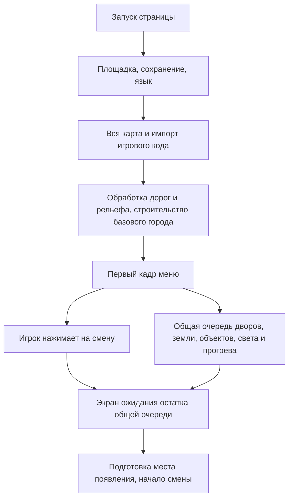

# Ускорение загрузки города и один игровой прогресс Жени

Спецификация следующему агенту, 01.11.2026. Беклог идей: [производительность №17](../plan/perf.md#q17), [один Женя №12](../IDEAS-ARCHIVE.md#c12). Целевая платформа — взрослая Steam-версия, высокая графика, Steam Deck.

**Основной вывод:** игра тратит время прежде всего на повторное построение города, а не только на чтение файлов. Меню появляется до завершения этой работы, но начало смены ждёт общую очередь. Нужно готовить неизменный город при сборке релиза и загружать вокруг игрока готовые участки. Уже существующую подгрузку земли следует развить, сохранив физику, адреса, правила районов и изменения мира.

**Уточнение автора 01.11:** профили и их переключение убрать полностью; один прогресс, героя всегда зовут **Женя**. Ускорять переключатель профилей больше не требуется. Удаление профилей само по себе не устранит долгую первую загрузку города.

Это задание на последующую реализацию. В этом заходе исследован текущий код, выполнены диагностические прогоны и обновлён беклог; игровой код не изменён. Основа анализа — `4de18035fca9394c0747e1a5ac6b9afd55a7a202`. Перед реализацией сверить изменения после этого коммита.

**Актуализация 02.11.2026:** №12 выпущен в v0.33.9 (`5a20287`): единственная карьера, проверяемая миграция до карты/игры, явный Retry при ошибке сохранения. Указанные ниже старые измерения профилей остаются историческим воспроизведением. №17ж/17а завершены: 36 одинаковых generated/cache запусков подтвердили выигрыш медиан19–22%, точность/отказ до публикации и отдельная память проверены; [все результаты](../measurements/landcache-2026-11-02/README.md). Первый пакет №17б включает готовые контуры ordinary района0 mid/high:12/12PASS, high cold81,3→66,0с / warm81,4→65,7с; [материалы](../measurements/landpackage-2026-11-02/README.md). Ограниченный ordinary адресный этап №17б прошёл локальную приёмку для первого ru/Deck mid/high запуска; [данные и границы](../measurements/ordinary-address-2026-11-02/README.md). Публикация v0.33.12 зависит от CI Linux/Windows. Граф оставлен generated: его чтение не подтвердило выигрыш. Следующий этап —17в; ранний каталог не снимает глобальный LATE-барьер. Это эмуляция high CPU×3, не физическая Deck.

## Что происходит сейчас



### Путь до меню

1. [main.js](../../src/main.js): `Platform.init` → выбор языка при необходимости → `initI18n` → проверяемая миграция единственного прогресса → `loadMap` → `useMap` → динамический импорт `game.js`. Ошибка переноса удерживает запуск до успешного Retry; карта, игровой модуль и старый `__boot` до этого не публикуются. Пока импорт игры не завершён, настоящего меню нет. Время, проведённое человеком в выборе языка или Retry, нужно исключать из измерения работы программы.
2. [maps/index.js](../../src/maps/index.js) загружает только выбранную карту, но [seversk/index.js](../../src/maps/seversk/index.js) импортирует весь `city-data.js` и `edits.json`. Разделение по картам уже есть; разделения данных Солнечного на загружаемые части пока нет.
3. В [game.js](../../src/game/game.js) при исполнении модуля идут `EDL.houses`, `WIDEN.widen`, `WORLD.prepCity`, `SMOOTH.smooth`, декодирование высот, `fixMap`, `RELIEF.addRelief`, `BEACH.shape`, `STREAMS.carve`, подготовка покрытий и пространственных индексов. Это не только создание картинки: результат нужен физике и движению.
4. `buildCity` немедленно вызывает `osmGround`, `osmRoads`, разметку, мосты, железную дорогу, `osmBuildings`, пиццерии и бордюры. Затем часть геометрии объединяется. Дальний дом может никогда не попасть на экран, но стоимость его построения уже оплачена.
5. `main.js` убирает заставку через два кадра после импорта. `__boot.menu` означает появление меню, а не готовность ехать.

### Работа после появления меню

[latebuild.js](../../src/game/latebuild.js) исполняет FIFO-очередь `LATE`: дворы, подъезды, деревья, парковки, стройки, реквизит, земля, сезоны, объединение мешей, загрузка в видеокарту, люди, транспорт, свет и прогрев материалов. Генераторы делят вычисления на шаги, но город всё равно обходится целиком для многих слоёв.

В `game.js` особенно важны четыре места:

- `LATE.add('raisedland', ...)`: сброс промежуточной геометрии, `RLAND.prepare` → `cleanContours` → `activate` → `alignObjects` → поправки сезонных объектов. Физическая опора становится готовой глобально.
- `raisedlandSurface`: при включённом `LAND_STREAM` строит подробную поверхность только рядом с пиццерией. Даже этот ограниченный набор сейчас вычисляется на компьютере игрока.
- `mesh`, `upload`, `shaders`, `warm`, `warmUse`: объединение геометрии, передача подготовленных мешей видеокарте, компиляция и первое использование материалов. Нельзя просто убрать прогрев: он защищает первые игровые кадры от остановок.
- `hold` в конце файла перехватывает раннее нажатие карточки смены, показывает `.late-wait` и вызывает `flushAsync`. `startRun`, быстрый заезд и повторный вход после сброса прогресса также имеют синхронные `LATE.flush`. Кроме того, `frameStep` во время `LATE.busy()` уходит в `lateFrame`, а не в обычную симуляцию. Одного удаления экрана ожидания недостаточно, чтобы игра безопасно заработала раньше.

Бюджет очереди ограничивает время между шагами, но **не прерывает длинный отдельный шаг**. В расчётах земли уже есть Worker через [landcleanpool.js](../../src/game/landcleanpool.js); предложить «добавить Worker» без разбора оставшейся работы недостаточно.

### Что уже подгружается и что только скрывается

| Система | Текущее устройство | Следствие для ускорения |
|---|---|---|
| [landstream.js](../../src/game/landstream.js) | Клетки `terrain.g * 16`, сейчас 256 м; стартовый радиус 640 м, запрос вокруг камеры 832 м; публикация целой клетки и маска старой земли | Основа потоковой загрузки уже есть. Нет чтения готовой геометрии, отмены текущей клетки и выгрузки посещённого |
| [raisedland.js](../../src/game/raisedland.js) | Общие `cover`, `green`, `finalMask`, опора; затем локальный рисунок | Разделять расчёт/чтение опоры и создание рисунка. Не менять высоту дороги после въезда |
| [cull.js](../../src/game/cull.js) | Индекс видимости по 128 м, отключение/отсоединение дальних мешей с сохранением ссылок; есть `register` новых групп | Скрытое остаётся в памяти. Для настоящей выгрузки нужен обратный путь удаления из индексов |
| [forest.js](../../src/game/forest.js), [lawnprops.js](../../src/game/lawnprops.js) | Собственные локальные клетки и освобождение удалённых | Подключить к общей политике готовности; не строить рядом второй независимый лес |
| [districts.js](../../src/game/districts.js) | Восемь зон доставки, текущая пиццерия, открытые районы, режим «весь город» | Правила заказов не должны зависеть от загруженных мешей |
| Адреса, граф дорог, `SOLIDS`, `SMASH`, зоны и точки появления | Многие списки заполняются внутри нынешних строителей | Сначала отделить описания объектов от их 3D-представления. Иначе после отсечения дальнего строительства исчезнут адреса, маршруты или препятствия |
| Машины и материалы | [realcar.js](../../src/game/realcar.js) кеширует загрузки моделей; [warmup.js](../../src/game/warmup.js) сохраняет программы | Общие ресурсы живут независимо от клетки. Смена участка не должна повторять их загрузку и компиляцию |
| Подъезды и диалоги | `stairs3d.create` создаёт отдельную сцену; `door2d.prepare/open` читает манифест и спрайты по требованию | Не загружать заранее все квартиры ради первой поездки; сохранить отдельную проверку первого входа к клиенту |
| Языки, музыка, звуки | Русский не читает словарь; остальные — свой и английский. Музыка/звуки читают индексы; звуки декодируются после подключения аудио | Все языки и всё содержимое `public` не являются обязательной загрузкой старта |

По инвентаризации исследованной сборки: исходные данные карты ≈1,97 МБ; главный игровой JS-кусок ≈5,87 МБ; в `game.js` 232 статических импорта. В `public/assets/dialogue` ≈27,94 МБ, но размер каталога на диске **не означает**, что он целиком читается при запуске. Размеры указаны в десятичных МБ. Сборка для probe включает редактор и может отличаться разбиением JS от обычного релиза. Приоритет загрузки/разбора модулей выбирать по трассе, не по сумме файлов поставки.

## Что показали измерения

Условия: один последовательный probe, Steam mode, 1280×800, `gfx=high&gfxdev=deck`, `--cpu=3 --bootcpu --seed=7 --early`, без звука. Новая временная сессия и сохранение; файловый кеш ОС не очищался. Русский язык выбран средствами probe, обычное обучение пропущено. Это **эмуляция на macOS**, не физическая Deck, не замер старта процесса Steam и не полный первый запуск новичка. GPU, накопитель, тепловой режим и Worker не следует считать точной моделью Deck только из-за CPU ×3.

| Показатель | Прогон без раннего нажатия |
|---|---:|
| `__boot.pre` — до импорта игры | 278 мс |
| `__boot.game` — импорт игры завершён | 14 346 мс |
| `__boot.menu` — меню появилось | 14 664 мс |
| `__boot.full` — общая очередь закончена | 105 026 мс |
| `LATE.T.total` — длительность очереди | 90 409 мс |
| `raisedland` — учтённая работа шага подготовки земли | 27 891 мс |
| `raisedlandSurface` — учтённая работа подробной поверхности | 17 926 мс |
| `yardcurbs` / `yardmaze` / `yardfill` | 4 674 / 3 250 / 2 639 мс |
| `yarddecor` / `entr` | 2 269 / 2 090 мс |
| Самый длинный шаг `raisedland` | 1 081 мс |

Источник: [lateboot.json](../measurements/loading-2026-11-01/lateboot.json). Один прогон показывает порядок величин и место работы, но не медиану. `LATE.T` считает время внутри вызовов очереди в основном потоке; время ожидания Worker и расписание кадров отдельно не выделены. `raisedland` включает больше, чем `cleanContours`, поэтому 27,9 с нельзя целиком обещать как выигрыш от кеша контуров. `__boot.full` также не равен первому управляемому кадру после нажатия.

В отдельном прогоне настоящая кнопка «сменить» нажата на 11,94-й секунде, когда в очереди оставалось 80 задач. Появился экран ожидания, список профилей открылся только через **78,63 с**, после окончания очереди на 90,11-й секунде. Это воспроизведение блокировки **открытия списка**, а не измерение применения другого сохранения. Последующая часть экспериментального сценария переключений завершилась ошибкой самого сценария `No profile picker`; времена переключений из неё не используются. Ошибок консоли игры не зарегистрировано. Исходный отчёт: [profiles.json](../measurements/loading-2026-11-01/profiles.json). После решения автора повторять оптимизацию переключателя не требуется.

Третий сценарий — существующий `shift-loading.js` с ранним нажатием настоящей карточки смены и CPU ×3: общая готовность на **115,54 с**, от нажатия до состояния езды **102,28 с**. Перед стартом готово **32 из 1776** участков подробной земли, работают три Worker, запасных пересчётов нет. После старта машина проехала 99 м; журнал ошибок пуст. После отладочного переноса к дальней пиццерии подготовка земли в радиусе 450 м заняла ещё **52,45 с**. Это телепорт, а не обычный въезд через соседние клетки. Источник: [shift.json](../measurements/loading-2026-11-01/shift.json).

Следствие: земля уже не строится подробно сразу во всех 1776 клетках, но старт всё равно долгий. Ограничиться предложением «включить подгрузку» нельзя: нужно убрать повторные вычисления общей основы и дорогую генерацию самих ближних участков. Три сценария выше различаются действиями игрока; их нельзя объединять в три повтора одного замера или усреднять как такой набор.

## Один прогресс и имя Женя

Связанная задача [Понятнее №12](../IDEAS-ARCHIVE.md#c12), размер **M**. Это самостоятельное изменение до большой переделки загрузки.

### Поведение для игрока

- На устройстве один текущий прогресс. Нет списка профилей, создания, переключения, переименования и удаления отдельного профиля.
- Герой — Женя. Нет запроса имени при первом запуске, редактирования имени в настройках, условий «введи имя, чтобы начать» и подстановки Steam-ника вместо имени персонажа. Обычный выбор языка остаётся.
- В меню, чеке смены, локальных рейтингах героя, репликах и карточке сотрудника используется единый источник имени. Для русского — `Женя`, для английского — `Zhenya`, через существующую локализацию. Падежи в обращениях проверить отдельно; массовую замену имён других персонажей не делать.
- Дядя Женя в гараже остаётся отдельным существующим персонажем. Новое имя героя не создаёт родства и не утверждает ранее обсуждавшуюся историю Димы.
- «Начать заново» остаётся отдельным осознанным действием с подтверждением. Оно сбрасывает карьеру, а не открывает окно профилей.
- Идентификатор аккаунта Steam и имена других участников внешних таблиц не переименовывать. Персонаж Женя и пользователь сервиса — разные сущности.

### Миграция существующего прогресса

Предлагаемое техническое решение агента: автоматически продолжить **последний активный профиль** из `dlv-profiles.cur`. Автор не просил обнулять карьеру или складывать несколько карьер. Профиль 1 сейчас хранится в обычных `dlv-*`, остальные — в `dlv-pN-*`; простое удаление `PROF.install` незаметно вернёт игрока из профиля 2–5 в старый профиль 1.

Миграция выполняется после готовности хранилища, **до любого чтения прогресса игровыми модулями**:

1. Прочитать и проверить старые метаданные. Нет метаданных — взять обычное старое сохранение; некорректный `cur` — применить явно протестированное правило восстановления списка, аналогичное прежнему `profiles.load`, записать диагностическую причину.
2. Снять резервный снимок исходных ключей и подготовить полный набор выбранной карьеры. Использовать объединение известных ключей и реально существующих ключей хранилища: одного `KNOWN` недостаточно для новых систем. Исключить общие настройки и служебные ключи по явной схеме.
3. Перенести выбранную карьеру в единственное каноническое пространство. Не смешать её с прежним профилем 1: отсутствующие у выбранной карьеры поля не должны наследоваться от него. Сначала подготовить и проверить снимок, затем публиковать результат; для многоключевого хранилища нужен журнал миграции и восстановление после прерывания.
4. Сохранить язык, графику, громкость, достижения и служебные данные. Имя персонажа привести к Жене независимо от старого имени и Steam-ника.
5. Маркер версии/успеха записать после успешной публикации. Повторный запуск не копирует старые данные заново. Прерывание на любом шаге не оставляет смесь карьер.
6. Старые профили сохранить как неактивный резерв для восстановления, без игрового интерфейса выбора; не удалять их автоматически в этом изменении. «Начать заново» сохраняет маркер миграции: старая карьера не должна воскреснуть при следующем запуске.

Локальный рейтинг сейчас определяет «это я» сравнением имени (`platform/common.js`, `localBoard`). После фиксации всем имени Женя эта проверка становится ненадёжной. Дать новым записям устойчивый идентификатор единственного сохранения; старые неоднозначные строки не присваивать герою только по совпадению имени. Исторические результаты не сливать и не стирать. Протестировать совместимость Steam Cloud с восстановленной локальной схемой и старым резервом.

### Точки изменения

| Код | Работа |
|---|---|
| `main.js`, `profiles.js`, `profiles.css` | Заменить установку многопрофильного хранилища одноразовой миграцией. Удалить многопрофильный интерфейс и неиспользуемые стили после снятия потребителей; миграционный читатель старой схемы остаётся отдельно |
| `menu.js`, `settings.js`, `honor.js`, HTML, обработчики геймпада | Убрать `.crm-swap`, `askName`, создание/переименование/выбор, привязку Y к профилям, модальные корни и пустые пункты фокуса; оставить доступ к полезной статистике героя |
| `game.js`: `S.name`, `myName`, `renderProfile`, начало смены, `reprofile`, сброс | Имя из единого источника. Логику сброса карьеры выделить из `reprofile` и сохранить без полной пересборки города, где это безопасно. Удалить только ветку ожидания профилей, а не все проверки готовности мира |
| `career.js`, `platform/common.js`, `web.js`, `steam.js`, `quickrun.js` | Рейтинги и подписи; разделить имя персонажа и аккаунт; быстрый заезд не должен портить основное сохранение |
| `CAREER.md`, `LORE.md`, `plan/hero.md`, ru/en | Обновить фактические правила вместе с кодом; старую гипотезу о произвольном имени героя явно отметить как заменённую решением автора |

**Приёмка №12:** чистый запуск сразу с Женей без поля имени; старые профили 1 и 2–5 с разными деньгами, машинами, районами и сюжетами; испорченные метаданные; повторная и прерванная миграция; сброс → перезапуск без восстановления старой карьеры; разные языки и Steam-ник; быстрый заезд → возврат; клавиатура и геймпад; локальные рекорды с одинаковыми старыми именами. Проверки проводить в изолированных сохранениях probe, не на сохранении автора.

## Как устроить быструю загрузку

### Районы задают игровой смысл, клетки задают загрузку

Идея автора верная по цели: не оплачивать подготовку дальнего города перед первой поездкой. Но восемь игровых районов слишком крупные и имеют неудобные границы. Камера видит соседний район, маршрут пересекает границу, игрок может развернуться или включить «весь город».

Для хранения и подгрузки использовать сетку **256 м**, совпадающую с текущей землёй. Район помогает выбрать место старта и поднять приоритет маршрута; он не разрешает показывать пустоту за своей границей. Не менять правила доступности заказов и езды ради ускорения.


### Разделить данные и вид

**Общие компактные данные:** адреса и идентификаторы домов/подъездов, пиццерии, дорожный граф и связи, районы, высоты, описания препятствий и событий. Они должны отвечать на вопросы игры без построенного меша. Сначала сохранить нынешнюю глобальную физическую опору и заменить её пересчёт чтением подготовленных данных; перенос физики на клетки не является обязательным первым шагом.

**Статика участков:** поверхности, дороги, дома, окна, дворы, расположение реквизита, таблицы экземпляров, необходимые локальные индексы. Общие материалы/шаблоны хранятся один раз. Не сериализовать весь `THREE.Scene` как непрозрачный снимок: так теряются понятное владение ресурсами и разделение изменяемого состояния.

**Изменения карьеры и смены:** разрушения, находки, рост пиццерий, последствия урагана, активные задания и акторы. Они накладываются поверх исходной статики по устойчивому ID. Срок жизни берётся из существующего правила: например, сбиваемое, которое `startRun` восстанавливает в новой смене, не следует внезапно сохранять навсегда. Выгрузка и возвращение в течение одной смены не восстанавливают разбитый объект.

**Удалённая симуляция:** на первом этапе сохранить нынешнюю логику событий, маршрутов и времени. Не включать одновременно новую модель «вдали жизнь останавливается»: это отдельное изменение правил, не условие загрузки рисунка.

### Подготовка данных при сборке релиза

Выделить чистый построитель данных или запускать существующие стадии в отдельном инструменте экспорта. Сначала пройти их в прежнем порядке, затем разделить результат на участки. Это безопаснее, чем одновременно переписывать каждый генератор: дворы учитывают стройки, парковки и соседей, а `EDL` закрепляет генерацию по именам стадий и номерам шагов.

Новый формат должен содержать:

- Манифест: версия формата и генератора, хеш карты, `edits`, настроек геометрии и всех влияющих входов, шаг сетки, координаты, список файлов, размеры и контрольные суммы. Хеш одного `city-data.js` недостаточен.
- Глобальный каталог отдельно от тяжёлой геометрии; типизированные числовые массивы в бинарных блоках с явными типами, длинами, смещениями и границами. Проверять данные до выделения больших буферов.
- Для участка: bounds, слои, ссылки на общие материалы/шаблоны, зависимости, ID объектов, объёмы CPU/GPU. Большие объекты имеют одного владельца и ссылки из пересекаемых клеток; видимость/загрузка определяется всем bounds, не только центром.
- Сезонные варианты, выбираемые во время игры, отделены от неизменной базы. Сборка не должна случайно запечь сезон, погоду, профиль или отладочный `--seed=7` как постоянное состояние релиза.
- Повторяемость генерации: сначала точное совпадение со старым путём; переход на независимое зерно по ID объекта/клетки делать контролируемо. Изменение количества `yield` в существующих seeded-стадиях может поменять сам город.

Генерация обязательна до упаковки Steam-версии. CI проверяет актуальность манифеста и наличие всех блоков. Отдельно проверить чтение через `app://` и упакованное приложение. В разработке — явный режим пересчёта/перегенерации с диагностикой устаревших данных. Ошибку готового набора не маскировать молчаливым использованием старого кеша.

### Контракт очереди и готовности

Выделить новую систему в отдельный модуль, например `citystream.js`; имена ниже — проектируемый API, сейчас его нет:

- `ensureAround(position, requirements, epoch) -> Promise`: готовит нужный набор для старта/телепорта.
- `updateDemand(camera, car, route)`: пересчитывает приоритеты и отменяет больше не нужную подготовку.
- `step(cpuBudgetMs, uploadBudgetBytes)`: ограниченная работа кадра через `CL.step`.
- `pin(ids, owner)` / `unpin(owner)`: удерживает текущую доставку, взаимодействия и акторов.
- `stats()`: время ожидания/чтения/декодирования/загрузки, очередь, готовые клетки, память, ошибки, самое долгое неделимое действие.

Состояния участка: `absent → queued → reading → decoded → uploading → ready → evicting → absent`, отдельно `failed`. Публиковать участок атомарно, только после готовности необходимых слоёв; затем закрывать старую подложку. Дублированный запрос использует ту же задачу. Ответ устаревшего поколения (`epoch`) после телепорта, сброса или отмены не меняет сцену. Ограничить число чтений, декодеров, подготовленных байт и GPU-загрузок, а не создавать `Promise.all` на всю карту.

Готовность входа: сохранение прочитано → точное место появления известно → физика и навигация готовы → полный обязательный видимый набор вокруг места появления опубликован → нужные программы и машина готовы → два реально отрисованных кадра и обработка управления. **Очередь всего города не обязана опустеть.** `__boot.full` оставить диагностикой старого пути, в новом ввести отдельные метки готовности меню, места появления и управления. Обновить проверки, которые сейчас ждут `full`.

Начальные радиусы сохранить: 640 м до начала движения, 832 м для подгрузки. Это стартовая конфигурация, не доказательство достаточности для любой камеры. Запас рассчитывать по видимой области, выносу камеры, максимальной скорости и измеренному худшему времени готовности: `запас >= скорость × время подготовки + запас камеры`. Передний сектор и ближайший маршрут получают повышенный приоритет, боковые направления остаются готовыми для разворота.

Начальный ориентир работы во время езды — около 1 мс CPU на кадр и до 4 мс на один неделимый шаг на целевом устройстве, затем уточнить по замерам. Размер передачи видеокарте подбирать по измеренному времени, а не произвольному количеству мешей. Превышение отдельного шага нельзя исправить только меньшим общим бюджетом.

До готовности клетки сохранять безопасную подложку и физику. При ошибке — ограниченные повторные попытки и явная диагностика. На переходе к далёкой пиццерии разрешён экран подготовки места назначения; в обычной езде не вводить регулярные экраны загрузки и невидимые стены. Если очередь не успевает за самой быстрой машиной, потоковый режим ещё не готов к выпуску: исправить размер/приоритеты/формат, а не выпускать пустоту.

### Освобождение памяти

Готовые клетки за внешним радиусом удержания освобождать по бюджету памяти и давности использования. Внешний радиус больше радиуса запроса: движение возле границы не должно вызывать постоянные загрузки туда-обратно. Числовой предел памяти определить по физической Deck с учётом общей памяти CPU/GPU; телефонные лимиты не использовать.

Выгрузка удаляет ссылки из `CULL`, индексов света/теней, физических локальных индексов, таблиц сбиваемого и владельцев; освобождает свои геометрии/буферы. Общие материалы и текстуры — через учёт владельцев, без преждевременного `dispose`. У `landstream` сейчас нет такой операции; `scene.remove` её не заменяет. Некоторые массивы освобождаются после `onUpload` уже сейчас: для повторного приезда нужен сохраняемый источник блока, а не попытка читать потерянный CPU-массив.

Состояние активных машин и событий отделить от принадлежности меша клетке; при пересечении границы нельзя создавать вторую машину. Закреплять область текущего взаимодействия. После большого круга и повторного круга число ресурсов и память должны выходить на плато.

## Этапы и порядок передачи

Общий размер №17 — **XL**. **Уточнение порядка автором 01.11:** сначала новый пакет правок управления, объектов, хада и вручения, затем №12, затем №17. Остальной прежний беклог снят с главной очереди; не вставлять его перед этими задачами. Очередь целиком находится в [IDEAS.md](../IDEAS.md). Внутри пакета №12/№17:

| Порядок | Задача | Размер | Что сдаёт агент |
|---:|---|:---:|---|
| 1 | Понятнее №12 — один Женя | M | Удалённые профили/ввод имени, безопасная миграция и сброс, обновлённые правила, проверенные сохранения |
| 2 | 17ж — измеримость старта | S | Новые метки стадий, отчёт до первого управления, раздельное время работы/ожидания, воспроизводимые контрольные прогоны |
| 3 | 17а — проба подготовленных контуров | S | Точная сериализация/восстановление результата `cleanContours`, три сравнения; подробное существующее задание сохраняется в треке |
| 4 | 17б — поставка готовых данных | M | Манифест, проверка целостности/совместимости, генерация и включение данных в релиз, автоматический запасной путь при допустимых сбоях |
| 5 | 17в — общая очередь и готовность места | M | Планировщик, отмена, ограничение памяти/передач, запуск по ближайшему набору; сначала слой земли. Если он ещё зависит от глобальных строителей, честно оставить эту зависимость до 17г |
| 6 | 17г — дороги, дома и дворы по участкам | L | Каталог отделён от геометрии, локальные готовые слои подключены по одному с сохранением адресов/стыков/правок; снята оставшаяся зависимость старта от всего города |
| 7 | 17д — выгрузка и восстановление | M | Явное владение ресурсами, сохранение изменений и акторов, возврат без дубликатов, память на плато |
| 8 | 17е — приёмка на Deck | M | Сравнение холодного/тёплого старта, первый запуск новичка, маршрут всех районов и возврат, реальные замеры устройства |

**Не продолжать автоматически неудачную гипотезу.** Проба 17а заменяет только очистку, а не весь `raisedland`, не построение ближайшей поверхности и не обработку дорог до меню. Если чтение/восстановление дороже расчёта или выигрыш теряется в разбросе, сохранить вывод и следующей взять реально дорогую стадию. Уменьшение разрешения, дальности, плотности города и удаление игрового содержимого в этот пакет не входят.

Раннее лёгкое меню без импорта всего `game.js` — возможный следующий шаг внутри 17в: выделить чтение единственного сохранения и независимые от сцены действия, затем запускать подготовку мира. Но оно считается улучшением только при отдельном сокращении времени до езды; второй долгий экран после красивого меню не является выполнением цели. Разносить все 232 импорта на динамические без трассы не нужно.

## Измерения и приёмка реализации

### Первый шаг агента

1. Прочитать `AGENTS.md`, этот файл, подробное задание [17а](../IDEAS-ARCHIVE.md#q17a), текущее состояние беклога и `git diff`. Работать в текущем checkout, чужие изменения и stash не трогать.
2. При назначении №12 сначала выполнить только удаление профилей с миграцией. При назначении №17 начать с 17ж; не считать исследовательские числа ниже полноценной приёмочной базой.
3. Сохранить неизменяемую контрольную сборку и записать SHA, изменения рабочей копии, режим, seed, настройки, CPU/GPU/ОС, версию Electron и точные команды. Обычная релизная сборка нужна отдельно от probe с редактором.
4. Снять минимум три независимых запуска контрольной и новой версии, последовательно. Отдельно: новая сессия, повторный запуск с кешем, первый запуск без обучения в сохранении, существующая карьера в ближнем и самом дальнем районе, повторный вход в смену. Начало процесса, выбор языка, показ меню, нажатие и первый управляемый кадр — разные метки.
5. Измерять чтение карты/блоков, разбор, генерацию до меню, каждую стадию `raisedland`, работу и ожидание Worker, создание поверхности, передачу GPU, прогрев и начало смены. Сохранять wall time, сумму CPU-шагов, максимальный шаг, число/байты запрошенных и опубликованных клеток. Не суммировать перекрывающиеся интервалы как общее время.

Команды, существующие на момент анализа (пути результатов агент выбирает сам):

```sh
bench_loading=$(mktemp -d /tmp/bird-loading.XXXXXX)
npx vite build --mode steam --outDir "$bench_loading/baseline"
npm run probe -- --mode=steam --dir="$bench_loading/baseline" --early --bootcpu --cpu=3 --seed=7 --size=deck '--q=gfx=high&gfxdev=deck&mute' --eval=tools/probe-checks/lateboot.js --report="$bench_loading/lateboot.json" --timeout=300
npm run probe -- --mode=steam --dir="$bench_loading/baseline" --early --bootcpu --cpu=3 --seed=7 --size=deck '--q=gfx=high&gfxdev=deck&mute&slowboot' --eval=tools/probe-checks/shift-loading.js --report="$bench_loading/shift.json" --timeout=300
```

Каждый обычный probe создаёт новую временную сессию; три команды probe не дают замер тёплого браузерного кеша. Для тёплого сценария расширить измерительный инструмент сохранением одной тестовой сессии и явным перезапуском страницы/процесса, не используя сохранения автора. Длительное ожидание человека при выборе языка считать отдельно. `slowboot` в существующем тесте расширяет срок ожидания, а не меняет нагрузку мира.

### Условия успешности

- **Продуктовая цель:** 5–10 с от запуска до возможности ехать на физической Steam Deck, высокая графика, без учёта времени выбора языка человеком. Это цель, не достигнутый результат и не обещание эффекта одной пробы.
- Для каждого этапа — три значения и медиана до/после, одинаковые условия, отсутствие ухудшения поездки. Если прирост меньше разброса, писать «не подтверждён».
- До первого управления не строятся и не передаются все дальние меши города. Это проверять счётчиками слоёв и байт, а не только `LAND_STREAM.stats.ready`: сейчас этот счётчик относится лишь к земле.
- Езда 10–15 минут на самой быстрой доступной машине: резкий разворот, боковые улицы, стыки клеток, границы районов, мост/берег, край карты, все пиццерии и возврат. Отдельно далёкий старт/перемещение, смена сезона, ночь/дождь, доставка в подъезд и выход обратно. p95/p99/максимум кадров, самые длинные шаги, опоздания клеток и память фиксируются.
- Земля, физика, адреса, маршруты и правки редактора совпадают. Проверять высоты, контуры, цвета, `initial`, семантику `domain`, положение объектов и устойчивые ID; равенства числа треугольников недостаточно. Подготовленная опора не прыгает при появлении подробного рисунка.
- Нет файла, неверный хеш/формат, обрыв блока, неверная длина массива, отказ Worker, повторный запрос, отмена и поздний ответ: нет вечной загрузки, частичной публикации и незаметного смешения версий. Фолбэк отмечается отдельно от успешного кеша.
- Сбитый предмет, подобранная находка и текущая доставка переживают выгрузку/возврат по своим прежним правилам. Нет двойных акторов и утечек ресурсов. Повторный круг не увеличивает память без ограничения.
- Использовать существующие `shift-loading`, `land-stream`, `land-tiles`, `land-fill`, `land-clip`, `land-workers`, `late-wait`, `cull-stream`, `shaders` и геометрические проверки из 17а по затронутым системам. После изменения контракта старта обновить их ожидания. Перед коммитом реализации — один `npm run check -- --serial`; адресные повторы только для найденных ошибок.
- Все тесты без звука. Физическую Deck отмечать отдельно от эмуляции. Мобильные и детские сборки не запускать.

В сдаче следующего агента обязательны: номер этапа, что реально включено в обычной игре, таблица до/после, отчёты и команды, сохранность старого прогресса, оставшиеся ограничения и следующий пункт беклога. Завершение небольшой пробы не закрывает весь №17.
